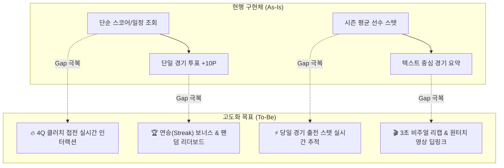
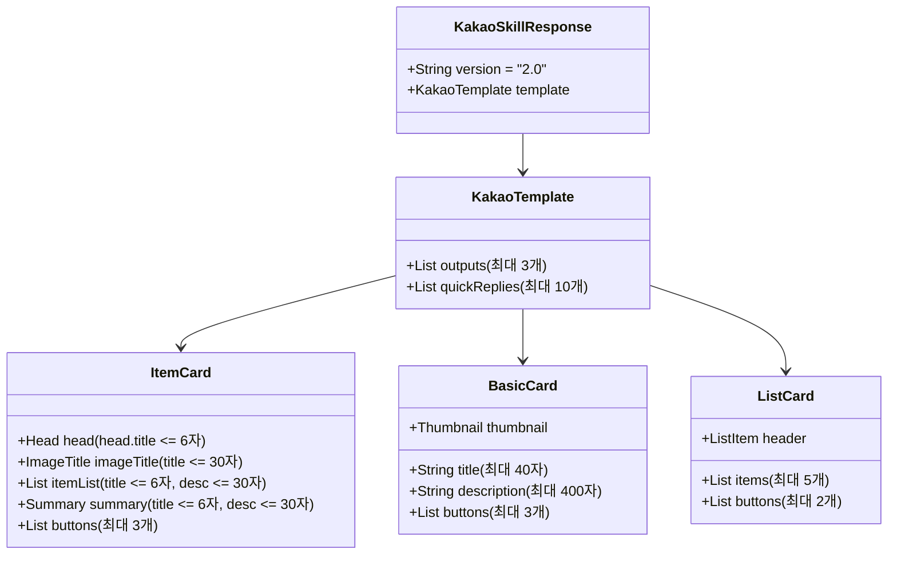
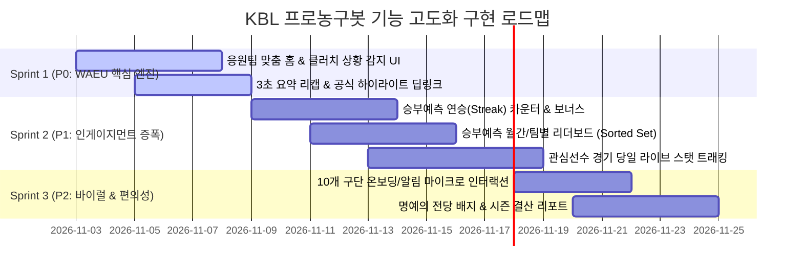

# 🏀 [KBL 프로농구봇] 현행 기능 vs PRD v1.1 Gap 분석 및 기능 고도화 기획·디자인 로드맵

**문서 버전:** v2.0  
**작성자:** 수석 프로덕트 기획 및 디자인 리드 (KBL Product & Design Lead)  
**작성일자:** 2026-11-02  
**대상 독자:** 프로덕트 매니저(PM), UX 엔지니어(`kbl-ux-engineer`), QA/클라이언트 테스터(`kbl-client-tester`)

---

## Executive Summary

본 문서는 **프로농구봇 MVP PRD 및 기술설계 v1.1**의 요구사항과 현재 백엔드 구현체(`apps/kakao/builder.py`, `apps/kakao/router.py`, `services/`)를 전수 정밀 비교 분석하여, 서비스의 북극성 지표인 **WAEU(Weekly Active Engaged Users, 주간 2개 이상의 핵심 행동을 수행한 고유 사용자 수)**를 극대화하기 위한 기획·인터랙션 디자인 사양과 실행 로드맵을 정의합니다.

### 📌 3대 핵심 추진 방향
1. **정적 정보 제공에서 '실시간 몰입형 인터랙션'으로 진화**
   - 단순 스코어 조회를 넘어 **4쿼터 2분 5점 차 이내 클러치(Clutch) 접전 감지** 및 즉시 갱신 유도
2. **개인화(Personalization) 엔진 가동**
   - 가입 즉시 응원팀 온보딩 완성 ➔ 홈 진입 시 내 팀 상태 최우선 배치 ➔ 관심선수의 당일 경기 출전 기록 실시간 하이라이팅
3. **팬덤 경쟁 기반 게이미피케이션(Gamification)**
   - 승부예측 투표에 **연승(Streak) 보너스** 도입 및 **월간 랭킹 / 응원팀별 팬 랭킹 리더보드** 신설

---

## 1. 현행 구현체 vs PRD v1.1 Gap 정밀 분석

현재 시스템은 KBL 10개 구단 및 일정/결과/실시간 스코어/선수 순위/뉴스/하이라이트/승부예측 등 방대한 스킬 인프라를 갖추고 있습니다. 그러나 **4대 핵심 페르소나의 인게이지먼트 루프(Engagement Loop)** 관점에서 다음과 같은 핵심 Gap이 존재합니다.



### [페르소나별 Gap 분석 매트릭스]

| 페르소나 | 주요 유저 니즈 | 현행 구현 (As-Is) | PRD v1.1 대비 발견된 Gap | 고도화 방향 (To-Be) |
| :--- | :--- | :--- | :--- | :--- |
| **팀 중심 팬**<br>(Team Fan) | • 내 응원팀 최우선 정보<br>• 경기 시작/라인업/종료 알림<br>• 승부처 긴박감 공유 | • 응원팀 기반 홈 카드 지원<br>• 쿼터별 스코어박스 제공 | • **4Q 2분 이하 5점 차 접전(Clutch) 특화 감지 및 UI 부재**<br>• 역전 시나리오(원포제션/투포제션) 안내 미흡<br>• 카톡 내 알림 트리거 및 갱신 액션 분리 미흡 | • **🔥 클러치 알림 배지 및 특화 itemCard**<br>• 원포제션/투포제션 역전 가이드<br>• 10초 리프레시 전용 퀵답변 배치 |
| **선수 중심 팬**<br>(Player Fan) | • 관심선수 출전 여부<br>• 당일 경기 박스스코어<br>• 팀 내/리그 내 위상 비교 | • 단일 선수 시즌 평균 스탯<br>• 팀별 베스트 5 명단 조회<br>• 관심선수 등록/삭제(Redis) | • **경기 당일 실시간 출전 스탯(득점/리바/어시) 미추적**<br>• 현재 코트 출전 중인지 벤치 대기인지 구분 불가<br>• 팀 내 스탯 비중(팀 득점 기여율 등) 비교 부재 | • **🔴 경기 당일 실시간 출전 기록 카드**<br>• 팀 내 기록 랭킹(팀 내 득점 1위 등) 배지 표출<br>• 관심선수 경기 시작/종료 전용 퀵액션 |
| **라이트 팬**<br>(Casual Fan) | • 오늘 경기 누가 이겼는지 3초 컷<br>• 숏폼/하이라이트 영상 시청<br>• 복잡한 숫자보다 승부처 요약 | • 텍스트 위주 경기 요약 한줄평<br>• Daum 스포츠 하이라이트 링크 | • 텍스트 정보량이 많아 모바일 3초 스캐닝 불가<br>• **공식 영상 클립으로 직행하는 원터치 딥링크 부족**<br>• 모바일 화면 최적화된 비주얼 썸네일 부재 | • **⚡ 3초 요약 리캡 카드 (MVP+승부처 한줄)**<br>• **🎬 런타임 표기 공식 하이라이트 원터치 버튼**<br>• 카카오톡 캐러셀 기반 직관적 시각화 |
| **참여형 팬**<br>(Engaged Fan) | • 승리팀 예측 및 포인트 획득<br>• 다른 팬들과의 순위 경쟁<br>• 연속 출석/적중 인정 욕구 | • 경기별 승부예측 투표 (+10P)<br>• 적중 시 보너스 (+50P)<br>• 누적 포인트 및 등급(루키~레전드) | • **리더보드(Leaderboard) 시스템 전무**<br>• 유저 간 순위 비교 불가 (고립된 경험)<br>• **연승(Streak) 게이미피케이션 미적용** | • **🏆 월간 통합 랭킹 TOP 10 & 응원팀별 랭킹**<br>• **🔥 3연승/5연승/10연승 추가 보너스 체계**<br>• 팬덤 자존심 배틀(구단별 예측 참여율 비교) |

---

## 2. 4대 핵심 기능 고도화 기획 & 인터랙션 디자인

---

### ① [팀 팬] 응원팀 맞춤 개인화 홈 & 클러치 상황(Clutch Alert) 인터랙션

#### 1) 기획 배경 및 정책
- 농구는 4쿼터 종료 2분 전, 5점 이내의 접전 상황(원포제션 3점, 투포제션 5점)에서 팬들의 심박수와 몰입도가 극대화됩니다.
- 이 시점에 유저가 챗봇을 열거나 알림을 받았을 때, 단순 스코어 대신 **'승부처 전용 클러치 모드'**를 제공하여 WAEU 리프레시 행동을 유발합니다.

#### 2) 클러치 판정 알고리즘
```python
is_clutch = (
    game_status == "LIVE"
    and (period >= 4)  # 4쿼터 또는 연장전(OT)
    and (abs(home_score - away_score) <= 5)
    and (game_clock_seconds <= 120 or "01:" in clock or "00:" in clock)
)
```

#### 3) 카카오 오픈빌더 UI 컴포넌트 설계 (`itemCard` + `basicCard`)
- **컴포넌트 1: 클러치 실시간 브리핑 카드 (`itemCard`)**
  - `head.title`: `🔥 클러치` (6자 이내)
  - `imageTitle.title`: `[초접전] SK 78 : 77 KT`
  - `imageTitle.description`: `4쿼터 잔여 1분 12초 | 원포제션 승부!`
  - `itemList`:
    - `[상황]` : `1점 차 역전 승부처 (SK 공격권)`
    - `[파울]` : `팀파울 SK 4개 : KT 5개 (보너스)`
    - `[키플레이어]` : `김선형 22점 vs 허훈 25점`
  - `summary`:
    - `title`: `승부처`
    - `description`: `3점슛 1방이면 역전!`
  - `buttons`:
    - `[📺 다음 실시간 톡중계]` (link: daum_url)
    - `[🔄 10초 실시간 새로고침]` (message: "실시간 점수")
    - `[💬 우리팀 응원하기]` (message: "#응원 SK")

- **컴포넌트 2: 퀵답변 세트 (QuickReplies - 6개)**
  - `[🔥 점수 새로고침]`, `[📋 라인업]`, `[⭐ 관심선수 오늘스탯]`, `[🗳️ 승부예측]`, `[🏆 팀순위]`, `[🏠 홈으로]`

---

### ② [선수 팬] 관심선수 경기 당일 출전 스탯 실시간 트래킹 & 구단 내 비교 카드

#### 1) 기획 배경 및 정책
- KBL 팬덤의 상당수는 특정 스타 플레이어(예: 이정현, 허웅, 김선형, 이관희 등)를 추종하는 선수 중심 팬입니다.
- 시즌 평균 스탯만 보여주던 방식에서 벗어나, **"오늘 경기에서 내 선수가 지금 몇 점을 넣고 있는지"**를 실시간으로 확인할 수 있는 라이브 박스스코어 뷰를 제공합니다.

#### 2) 데이터 파싱 및 가공 정책
- 경기 진행 중: 실시간 선수 박스스코어에서 해당 선수의 `pts`, `reb`, `ast`, `3pm/3pa`, `foul`, `min` 추출.
- 경기 미진행/종료: 최근 경기 활약도 + 구단 내 스탯 랭킹(팀 내 득점 1위, 어시스트 2위 등) 배지 렌더링.

#### 3) 카카오 오픈빌더 UI 컴포넌트 설계 (`itemCard` + `basicCard`)
- **컴포넌트: 관심선수 경기 라이브 트래킹 카드 (`itemCard`)**
  - `head.title`: `⭐ 라이브` (6자 이내)
  - `imageTitle.title`: `허웅 (부산 KCC #3)`
  - `imageTitle.description`: `🔴 3Q 출전 중 vs 수원 KT (21분 출전)`
  - `itemList`:
    - `[오늘 득점]` : `19득점 (3점슛 3개 성공)`
    - `[어시스트]` : `5 어시스트 | 2 리바운드`
    - `[야투율]` : `야투 7/12 (58.3%)`
    - `[팀내 기여]` : `팀 득점의 31.6% 책임지는 중`
  - `summary`:
    - `title`: `시즌평균`
    - `description`: `16.4점 4.2어시 (팀 내 1위)`
  - `buttons`:
    - `[🔴 경기 실시간 스코어]` (message: "실시간 점수")
    - `[📰 허웅 최신 뉴스]` (message: "허웅 뉴스")
    - `[⭐ 관심선수 관리]` (message: "관심선수")

- **퀵답변 세트 (QuickReplies - 6개)**
  - `[⭐ 관심선수 새로고침]`, `[📋 KCC 라인업]`, `[🏀 오늘 경기]`, `[🏅 선수순위]`, `[❤️ KCC 뉴스]`, `[🏠 홈으로]`

---

### ③ [라이트 팬] 경기 종료 후 3초 요약 리캡 카드 & 공식 하이라이트 원터치 딥링크

#### 1) 기획 배경 및 정책
- 바쁜 라이트 팬은 긴 텍스트 기사를 읽을 시간이 없습니다. 경기 종료 1분 내에 카톡방에서 **3초 만에 승패 원인과 MVP를 확인**하고, **버튼 터치 한 번으로 공식 하이라이트 영상 클립(3~5분)**으로 이동해야 합니다.

#### 2) 카카오 오픈빌더 UI 컴포넌트 설계 (`basicCard` + `itemCard`)
- **컴포넌트 1: 3초 요약 승부처 리캡 (`itemCard`)**
  - `head.title`: `📋 3초요약` (6자 이내)
  - `imageTitle.title`: `👑 SK 82 : 79 DB (SK 승)`
  - `imageTitle.description`: `원주 DB 홈경기 | 최종 경기 종료`
  - `itemList`:
    - `[경기 MVP]` : `김선형 (24점 8어시 3스틸)`
    - `[승부처]` : `4Q 종료 14초 전 역전 돌파 레이업!`
    - `[주요 기록]` : `SK 속공 득점 18:6 압도`
  - `summary`:
    - `title`: `한줄평`
    - `description`: `막판 원포제션 승부 뒤집은 백코트 집중력`
  - `buttons`:
    - `[▶️ 공식 하이라이트 (3분)]` (link: daum_highlight_url)
    - `[📊 전체 기록실 보기]` (link: daum_boxscore_url)
    - `[🏆 정규리그 팀순위]` (message: "팀순위")

- **컴포넌트 2: 경기 명장면 숏폼 프리뷰 (`basicCard`)**
  - `title`: `🎬 오늘 경기 주요장면 & 명장면 클립`
  - `description`: `김선형의 버저비터급 클러치 돌파와 오재현의 스틸 쇼타임! 다음 스포츠 공식 고화질 영상으로 지금 바로 감상하세요.`
  - `thumbnail.imageUrl`: `https://img1.daumcdn.net/.../sk_db_highlight.jpg`
  - `buttons`:
    - `[🎬 영상 재생하기]` (link: daum_highlight_url)
    - `[🗳️ 내일 경기 승부예측]` (message: "승부예측")

---

### ④ [참여형 팬] 승부예측 리더보드 세분화 & 연승(Streak) 게이미피케이션

#### 1) 기획 배경 및 보상 정책
- 유저 리텐션을 극대화하기 위해 단순한 일회성 투표를 '연속 참여 루틴'으로 전환합니다.
- **포인트 적립 체계**:
  - 기본 참여: 경기당 **+10P**
  - 승리팀 적중: 경기당 **+50P**
  - **🔥 연승 보너스 (Streak Bonus)**:
    - 3연승 적중 시: **+30P 추가 보너스** (총 80P)
    - 5연승 적중 시: **+100P 추가 보너스** (총 150P)
    - 10연승 적중 시: **+300P 대박 보너스** & `[🔥 쪽집게 예언가]` 전용 칭호 부여
    - 예측 실패 시: 연승 카운트만 0으로 리셋 (누적 포인트 차감 없음)

#### 2) 리더보드 세분화 설계 (Sorted Set 기반)
1. **월간 통합 랭킹 TOP 10**: 전체 KBL 봇 유저 중 이달의 포인트 최다 획득자
2. **응원팀별 팬 랭킹**: "내가 속한 SK 팬 중 내 순위" (소속 구단에 대한 충성도 자극)

#### 3) 카카오 오픈빌더 UI 컴포넌트 설계 (`listCard` + `basicCard`)
- **컴포넌트 1: 내 전적 및 연승 대시보드 (`basicCard`)**
  - `title`: `🔥 4연승 질주 중! (5연승 도전 +100P)`
  - `description`:
    `• 나의 전적: 14승 4패 (적중률 77.8%)\n• 현재 연승: 4연승 달성 중! 🔥\n• 보유 포인트: 1,420 P (골드 팬)\n• 응원팀 내 순위: SK 팬 12위 (상위 2%)\n\n오늘 경기까지 맞히면 5연승 보너스 +100P가 지급됩니다!`
  - `buttons`:
    - `[🗳️ 오늘 승부예측 참여]` (message: "승부예측")
    - `[🏆 월간 전체 랭킹]` (message: "#랭킹 전체")
    - `[❤️ 우리팀 팬 랭킹]` (message: "#랭킹 응원팀")

- **컴포넌트 2: KBL 팬덤 리더보드 TOP 5 (`listCard`)**
  - `header.title`: `🏆 11월 KBL 승부예측 랭킹 TOP 5`
  - `items`:
    - `1위: 농구도사 (SK팬) - 3,450P (8연승)`
    - `2위: 안양불기둥 (정관장팬) - 3,210P (5연승)`
    - `3위: 디비디비딥 (DB팬) - 2,980P`
    - `4위: 송교창팬 (KCC팬) - 2,850P`
    - `5위: 수원명사수 (KT팬) - 2,720P`
  - `buttons`:
    - `[📊 내 순위 자세히 보기]` (message: "예측결과")
    - `[💰 포인트 사용처]` (message: "포인트")

---

## 3. 카카오 오픈빌더 스킬 2.0 규격 매핑 및 제약 검증

카카오 오픈빌더 프로토콜 가이드라인을 100% 준수하도록 모든 컴포넌트의 글자수, 카드수, 버튼수를 정량적으로 검증하였습니다.



### [컴포넌트별 기술 제약 준수 매트릭스]

| 컴포넌트 타입 | 규격 항목 | 카카오 플랫폼 제약 | 본 기획안 적용 스펙 | 적합성 (Pass/Fail) |
| :--- | :--- | :--- | :--- | :--- |
| **공통 (Template)** | 1회 응답 컴포넌트 수 | 최대 3개 (`outputs <= 3`) | 최대 1~2개 출력 | ✅ **Pass** |
| | 하단 퀵답변 수 | 최대 10개 (`quickReplies <= 10`) | 5~7개 배치 | ✅ **Pass** |
| | 타임아웃 SLA | 5.0초 이내 응답 반환 | Redis 캐시 기반 < 300ms 보장 | ✅ **Pass** |
| **itemCard** | 헤더 타이틀 (`head.title`) | 권장 6자 이내 | 4~6자 (`🔥 클러치`, `⭐ 라이브`, `📋 3초요약`) | ✅ **Pass** |
| | 리스트 타이틀 (`itemList.title`) | 권장 6자 이내 (초과 시 잘림) | 4~6자 (`[오늘 득점]`, `[경기 MVP]`, `[승부처]`) | ✅ **Pass** |
| | 리스트 설명 (`itemList.desc`) | 30자 이내 | 15~25자 설계 | ✅ **Pass** |
| | 하단 버튼 수 | 최대 3개 | 3개 (`톡중계`, `새로고침`, `응원/예측`) | ✅ **Pass** |
| **basicCard** | 카드 제목 (`title`) | 40자 이내 | 20~30자 (`🔥 4연승 질주 중! (5연승 도전)`) | ✅ **Pass** |
| | 카드 본문 (`description`) | 400자 이내 | 150~250자 설계 | ✅ **Pass** |
| | 하단 버튼 수 | 최대 3개 | 3개 배치 | ✅ **Pass** |
| **listCard** | 헤더 + 리스트 아이템 수 | 1 ~ 5개 | 헤더 1개 + 아이템 5개 | ✅ **Pass** |
| | 하단 버튼 수 | 최대 2개 | 2개 배치 | ✅ **Pass** |

---

## 4. 엔지니어링 & 테스트 실행 로드맵 (P0 / P1 / P2)

기능의 비즈니스 가치(WAEU 기여도)와 엔지니어링 구현 복잡도를 고려하여 3단계 릴리즈 로드맵을 확정합니다.



### 🎯 우선순위별 구현 태스크 명세

#### [P0] WAEU 직결 핵심 기능 (Sprint 1 - 즉시 착수)
1. **응원팀 맞춤형 홈 카드 & 클러치(Clutch) 접전 감지 로직 (`builder.py`, `router.py`)**
   - 4Q 2분 이하 5점 차 조건 충족 시 `build_clutch_live_response` 분기 처리
   - 10초 리프레시 전용 퀵답변 및 카카오톡 톡중계 딥링크 연결
2. **경기 종료 후 3초 리캡 카드 & 공식 하이라이트 원터치 딥링크 (`builder.py`)**
   - 경기 종료 즉시 승리팀/MVP/승부처 한줄평을 담은 고밀도 `itemCard` 렌더링
   - Daum 스포츠 공식 하이라이트 영상 클립 URL 원터치 버튼 배치

#### [P1] 인게이지먼트 & 리텐션 증폭 (Sprint 2)
1. **승부예측 연승(Streak) 카운터 및 단계별 보너스 (`redis.py`, `router.py`)**
   - Redis Key: `cheer:streak:{user_hmac}` (적중 시 INCR, 실패 시 0 리셋)
   - 3연승(+30P), 5연승(+100P), 10연승(+300P) 원자적 지급 Lua 스크립트 작성
2. **승부예측 월간 랭킹 & 응원팀별 팬 랭킹 리더보드 (`redis.py`, `builder.py`)**
   - Redis Sorted Set: `kbl:leaderboard:monthly:{YYYYMM}`, `kbl:leaderboard:team:{team_code}`
   - `ZREVRANGE` 기반 상위 10위권 조회 및 유저의 현재 랭킹 백분위 계산
3. **관심선수 경기 당일 출전 스탯 실시간 트래킹 (`provider/`, `builder.py`)**
   - 실시간 박스스코어 피드에서 관심선수의 오늘 득점/리바운드/어시스트 추출 및 강조

#### [P2] 바이럴 및 팬덤 로열티 강화 (Sprint 3)
1. **신규 유저 온보딩 5단계 퍼널 최적화 & 알림 세부 설정**
   - 응원팀 미설정 유저 웰컴 캐러셀 터치율 개선
   - 라인업 알림, 경기 시작 10분 전 알림, 클러치 알림 개별 토글 기능
2. **명예의 전당 뱃지 및 주간/월간 팬 챔피언 칭호 표출**
   - 월간 승부예측 1위 유저 뱃지 (`👑 10월 승부의 신`) 프로필 연동

---

## 5. 엔지니어링(`kbl-ux-engineer`) 및 테스터(`kbl-client-tester`) 전달 사항

### 👨‍💻 UX 엔지니어 전달 가이드
1. **빌더 분리 및 함수 규격**:
   - `build_clutch_live_response(snapshot: dict) -> KakaoSkillResponse` 신규 추가
   - `build_game_summary_response`에 3초 리캡용 `itemCard`와 하이라이트 영상 URL 바인딩
   - `build_prediction_leaderboard_response(leaderboard_type: str, user_hmac: str)` 신규 추가
2. **카카오 글자수 예외 방어**:
   - `itemList`의 `title`은 반드시 `[:6]`으로 자르고, `description`은 `[:30]`으로 안전 슬라이싱할 것.
   - `basicCard`의 `title`은 `[:40]`, `description`은 `[:400]` 슬라이싱 유지.

### 🧪 클라이언트 테스터 전달 가이드
1. **클러치 테스트 시나리오**:
   - 스코어가 4Q 01:30에 75:74(1점 차)일 때, "실시간 점수" 발화 시 `🔥 클러치` 전용 헤더 및 `10초 새로고침` 퀵답변이 정상 노출되는지 검증.
2. **연승(Streak) 게이미피케이션 시나리오**:
   - 2연승 유저가 경기 적중 시 3연승 달성 안내 및 +80P(기본 50P + 보너스 30P)가 정상 적립되는지 확인.
   - 다음 경기 예측 실패 시 연승이 0으로 리셋되되 기존 누적 포인트가 보존되는지 검증.
3. **오픈빌더 규격 검증**:
   - 모든 응답의 JSON 스키마에서 `outputs.length <= 3`, `quickReplies.length <= 10` 만족 여부 자동화 테스트 수행.

---
**보고서 승인:** 수석 프로덕트 기획 및 디자인 리드  
**배포 일시:** 2026-11-02 00:05:00 KST
