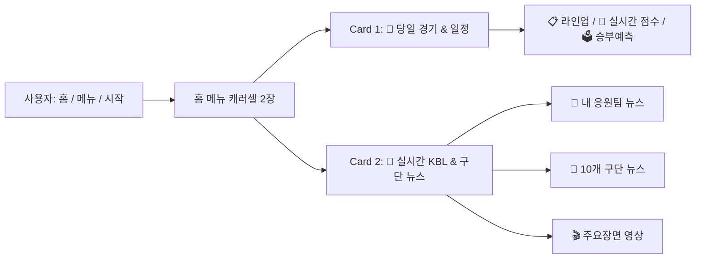

# Design Spec: 처음 화면(홈 메뉴) 뉴스 블록 추가 및 캐러셀 확장

## 1. 개요 및 목적
- **문제점**: 사용자가 챗봇에 처음 진입하거나 "홈", "메뉴"를 호출했을 때, 당일 경기 카드 1장만 노출되고 뉴스 관련 진입점(카드 및 하단 퀵리플라이)이 부재하여 핵심 기능인 KBL 최신 뉴스 및 구단별 소식을 발견하기 어려움.
- **해결 방안**:
  1. 홈 메뉴 응답을 2장의 가로 스와이프 캐러셀(Carousel)로 확장:
     - **Card 1**: 당일 경기/일정/라이브 상태 카드 (매치업 및 액션 버튼)
     - **Card 2**: `[📰 실시간 KBL & 구단 뉴스]` 전용 카드 (응원팀 뉴스, 10개 구단 뉴스, 하이라이트 영상 바로가기)
  2. 전역 퀵리플라이(`MAIN_MENU_QUICK_REPLIES`, 최대 10개)에 `[📰 최신 뉴스]`를 핵심 위치(3번)에 배치하여 챗봇 어느 화면에서나 1초 만에 뉴스 피드로 진입 가능하도록 개선.

---

## 2. 세부 설계

### 2.1 홈 메뉴 캐러셀 구조 (`apps/kakao/builder.py`)
`build_home_menu_response(favorite_team, fav_players, team_game)`:

#### Card 1: 당일 경기/일정 카드
- **제목**: `🔴 [LIVE] ...` / `📅 [경기 안내] ...` / `✅ [승리/종료] ...` / `🏀 {full_team}`
- **설명**: 경기 시각, 구장, 매치업, 관심선수 요약
- **버튼**:
  - LIVE: `[🔴 실시간 점수]`, `[📋 선발 라인업]`, `[🗳️ 승부예측 참여]`
  - SCHEDULED: `[📋 선발 라인업]`, `[🗳️ 승부예측 참여]`, `[📰 팀 뉴스]`
  - FINAL: `[🎬 주요장면 보기]`, `[🏆 정규리그 순위]`, `[📰 팀 뉴스]`
  - 경기가 없는 날: `[📅 오늘 경기]`, `[🗳️ 오늘 승부예측]`, `[📰 팀 뉴스]`

#### Card 2: 실시간 KBL & 구단 뉴스 카드 (신규)
- **제목**: `📰 실시간 KBL & 구단 뉴스`
- **설명**: 
  - 응원팀 설정 시: `🏀 내 응원팀 {full_team} 주요 소식과 KBL 최신 속보를 실시간으로 확인하세요!`
  - 응원팀 미설정 시: `🏀 KBL 10개 구단 최신 소식과 현장 인터뷰를 실시간으로 확인하세요!`
- **썸네일**: KBL 스포츠 뉴스 배너 이미지
- **버튼 (3개)**:
  - Button 1: `[📰 {fav_team} 뉴스]` (응원팀이 있으면 해당 팀 뉴스, 없으면 `[📰 KBL 최신 뉴스]`)
  - Button 2: `[🏀 10개 구단 뉴스]` (메시지: `구단별 뉴스`)
  - Button 3: `[🎬 오늘 경기 주요장면]` (메시지: `주요장면`)

---

### 2.2 전역 퀵리플라이 최적화 (`MAIN_MENU_QUICK_REPLIES`)
카카오 오픈빌더 최대 규격인 10개 한도 내에서 정보 접근성을 극대화:
1. `🏀 오늘 경기`
2. `🔴 실시간 점수`
3. `📰 최신 뉴스` ⭐️ (신규 탑재)
4. `🗳️ 승부예측`
5. `📋 라인업`
6. `⭐ 관심선수`
7. `📅 일정`
8. `🎬 주요장면`
9. `🏆 팀순위`
10. `⚙️ 설정`

---

### 2.3 라우터 발화 처리 (`apps/kakao/router.py`)
- 발화 정규화: `최신 뉴스`, `최신뉴스`, `뉴스`, `구단별 뉴스`, `구단뉴스` 입력 시 `build_news_response` 및 `build_team_news_menu_response`로 원활하게 매핑.
- 응원팀이 있을 때 `{fav_team} 뉴스` 버튼 터치 시 구단 전속 뉴스로 바로 진입.

---

## 3. 검증 계획
1. **단위 테스트 (`tests/test_kakao_builder.py`)**:
   - `build_home_menu_response` 호출 시 반환되는 `outputs[0]['carousel']['items']`의 길이가 2장인지 검증.
   - Card 2의 제목 및 뉴스 버튼 구성 검증.
   - `MAIN_MENU_QUICK_REPLIES`에 `📰 최신 뉴스`가 포함되고 총 개수가 10개인지 검증.
2. **전체 테스트 검증**:
   - `python3 -m pytest -v` (151개 이상 전수 통과 확인).
3. **OCI 프로덕션 실서버 배포 및 봇 응답 실측**:
   - 실서버 배포 후 `홈` 및 `메뉴` 발화 시뮬레이션을 통해 2장 캐러셀 및 뉴스 버튼 정상 응답 검증.
